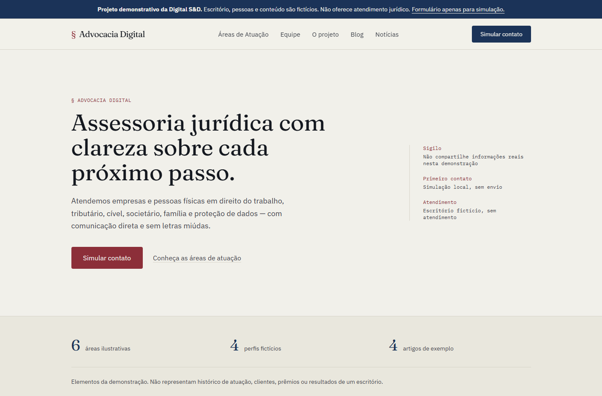

# Advocacia Digital — Digital S&D demo

[Português](README.md) · [Portfolio case](https://digitalsd.com.br/portfolio/advocacia-digital/) · [Project enquiries](mailto:digitalsd.contato@gmail.com)

## Purpose and scope

A fictional professional-services website with 26 static pages: practice areas, team profiles, articles, news, FAQ and a simulated enquiry form. The firm, people and editorial samples are fictional. It provides no legal advice or service, demonstrates no professional credentials and is not a client project.

## Screenshots

[Practice areas](docs/capturas/areas.png) · [Simulated enquiry](docs/capturas/contato.png) · [Mobile](docs/capturas/mobile.png).

## Run and structure

Use Node.js 24: `npm ci`, `npm run check`, then `npm run preview -- --host 127.0.0.1 --port 4321`. Development uses `npm run dev`. Astro 7 and Tailwind 4 build the static site into `dist/`; there is no serverless adapter or required secret. Content lives in `src/lib/content.ts` and types in `src/lib/types.ts`, with bundled local fonts. No CMS integration is implemented.

## Features and limitations

Related service and editorial pages, responsive navigation with Escape support, keyboard-operable FAQ and local form validation. Use fictional examples only. The form validates required fields, Brazilian phone format, allowed area, message and demo acknowledgement, then clears the fields and goes to `/obrigado` without field values in the URL. Without JavaScript, fields remain disabled. It sends and persists no form values. There is no API, email, CRM, WhatsApp or analytics connection. Hosting may retain technical navigation logs.

All pages identify the demo and use `noindex, nofollow`; no unverified firm domain or LegalService schema is used. Real deployment requires authorised content and credentials, suitable review and confirmed delivery of enquiries.

## Team and verification

A Digital S&D team project, founded by Álvaro Marinho and Arthur Leite; sole authorship is not claimed. The public case separates proposed needs, implementation decisions and evidence from client outcomes.

`npm run check` runs Astro diagnostics, build and six Node tests. This revision passed with no Astro errors or warnings, 26 generated pages and six passing tests covering validation, demo notices, local assets/links and no-collection behaviour. The running enquiry flow was also checked with fictional data.
