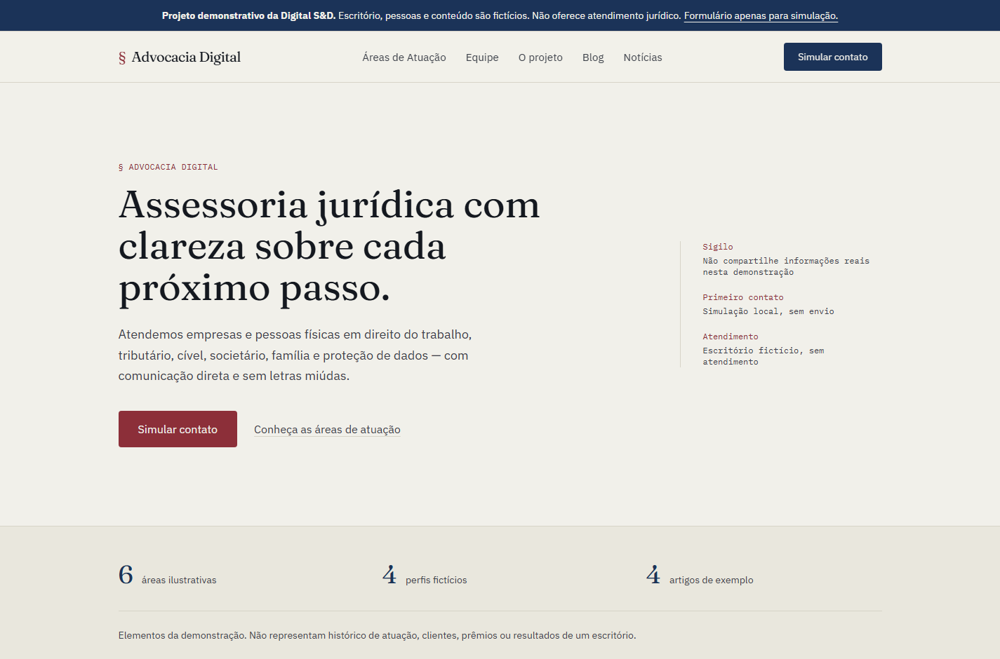

# Advocacia Digital — demonstração da Digital S&D

[English](README.en.md) · [Caso público](https://digitalsd.com.br/portfolio/advocacia-digital/) · [Contato com a SD](mailto:digitalsd.contato@gmail.com)

Conceito de site institucional com 26 páginas estáticas: áreas de atuação, perfis fictícios, blog, notícias, perguntas frequentes e simulação de contato. Escritório, pessoas e textos são fictícios. Não oferece atendimento ou orientação jurídica, não comprova credenciais e não é um projeto de cliente.

## Executar e verificar

Use Node 24 LTS e npm. O lockfile registra as versões verificadas.

```sh
npm ci
npm run check
npm run preview -- --host 127.0.0.1 --port 4321
```

`check` executa `astro check` (falha em erros ou avisos), build e testes Node. O build isolado é `npm run build`; desenvolvimento: `npm run dev`. A checagem oficial de arquivos Astro está documentada em [TypeScript no Astro](https://docs.astro.build/en/guides/typescript/).

Astro 7, Tailwind 4, fontes locais Fraunces/IBM Plex e Zod. TypeScript 5.9 é usado porque está na faixa suportada pelo peer dependency de `@astrojs/check` 0.9.12; TypeScript 7 não está nessa faixa. O alias usa caminho relativo, sem `baseUrl` legado.

## Contato demonstrativo

O formulário valida nome, formato de telefone brasileiro com DDD, e-mail, área permitida, mensagem e confirmação do caráter demonstrativo. A validação de telefone não confirma existência ou titularidade. Erros são associados ao campo e o foco é levado ao primeiro erro.

Use apenas exemplos fictícios. A aplicação não envia, registra em logs ou persiste os valores. Ao concluir, limpa os campos e navega a `/obrigado`, sem dados na URL, com aviso de simulação. Sem JavaScript os campos permanecem desabilitados e o método `dialog` impede uma submissão HTTP acidental. Não há API, e-mail, CRM, WhatsApp, analytics ou CMS conectado. O provedor de hospedagem pode manter logs técnicos de navegação conforme sua configuração.

## Conteúdo e publicação

O conteúdo fica em `src/lib/content.ts`, com tipos em `src/lib/types.ts`. Não há integração Prismic implementada. Rankings, números de clientes, credenciais acadêmicas e inscrições OAB inventados foram retirados. A página com a rota histórica `/resultados-e-reconhecimento` explica o escopo do conceito.

Todas as páginas têm aviso visível de demonstração e `noindex, nofollow`. Não há domínio de escritório atribuído, canonical de domínio não confirmado ou schema `LegalService`. Isso é intencional para não apresentar o conceito como uma empresa real. O case de portfólio da Digital S&D tem seus próprios metadados e pode ser indexado.

O artefato é `dist/`, sem adaptador ou função serverless. Publique esse diretório em hospedagem estática com rotas de diretório (`/contato` → `/contato/index.html`) e `404.html`. Confira também a [documentação de deploy do Astro](https://docs.astro.build/en/guides/deploy/). Não é necessário configurar segredos ou variáveis de ambiente para esta demonstração.

Uma implantação para escritório real exige conteúdo e credenciais autorizados, revisão jurídica/publicitária, identidade e canais reais, política de privacidade correspondente ao tratamento efetivo e integração de contato com recebimento comprovado. Esses serviços não são simulados como já concluídos.

## Regressões cobertas

- Formatos de telefone, área inválida, campos obrigatórios, limites e confirmação.
- Todas as 26 páginas: um H1, aviso demonstrativo, `noindex` e ausência de credenciais/rankings/canais fictícios acionáveis.
- Links, recursos e âncoras internas do artefato exportado.
- Ausência de API de coleta e confirmação sem falsa promessa de recebimento.

A verificação visual complementar cobre larguras mobile/desktop, menu com Escape, FAQ por teclado e formulário em execução. `npm audit` é uma fotografia dos avisos conhecidos, não uma garantia permanente de segurança.

## Capturas e participação



[Áreas de atuação](docs/capturas/areas.png) · [Contato simulado](docs/capturas/contato.png) · [Versão mobile](docs/capturas/mobile.png). Capturas da implementação atual em execução.

Projeto da equipe Digital S&D, fundada por Álvaro Marinho e Arthur Leite. Não se atribui toda a implementação a uma única pessoa. O caso público explica o problema proposto, decisões e limites; o contato comercial da SD é separado da simulação jurídica. Nesta revisão, `npm run check` passou com 0 erros/avisos no Astro, 26 páginas exportadas e seis testes. O fluxo de contato foi conferido com dados fictícios em execução.
